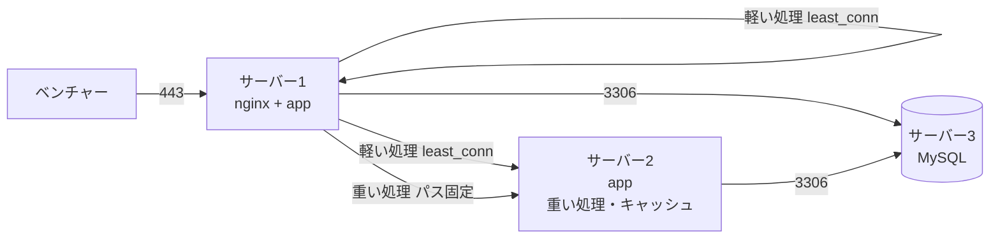
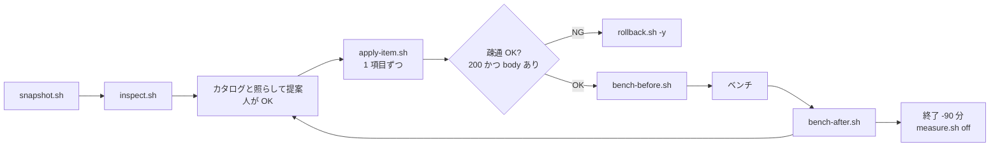

# インフラ秘伝のタレ（ISUCON2026）

## TL;DR

- 本番の構成は当日まで分からない。だから**固定の設定ファイルは置かず、カタログ（`catalog.md`）と汎用スクリプトだけ**を持ち込む
- 当日の流れ: `snapshot.sh`（初手で丸ごと退避）→ `inspect.sh`（実機を読む）→ カタログと照らして提案（SKILL `infra-tuning`、人が OK）→ `apply-item.sh`（1 項目ずつ。差分 → バックアップ → 反映 → 疎通確認）
- **構成には触らない**。既存ファイルは数値の書き換えだけ、新しい設定は追記ファイルだけ。構成に触る項目はカタログで ✕ にして opt-in
- 3 台構成（サーバー1: nginx + app、サーバー2: app、サーバー3: DB）。nginx のパス振り分けで重い処理をサーバー2 に寄せる
- 戻すときは `restore-all.sh`（全部）か `rollback.sh -y <名前>`（1 回分）

## ファイル構成

| パス | 中身 | 使う場面 |
|---|---|---|
| `catalog.md` | **チューニング項目のメモ**。項目ごとに 対象 / 決め方 / なぜ / 当てない条件 / 確認 / 副作用。○△✕ の既定 | 当日、inspect の結果と照らして読む |
| `scripts/snapshot.sh` | **初手スナップショット**。`/etc/nginx` `/etc/mysql` `/etc/sysctl.d` `/etc/security/limits.d` `/etc/systemd/system`、env、sysctl 全値、MySQL のユーザーと GRANT を退避 | 各台で最初に 1 回 |
| `scripts/restore-all.sh` | スナップショットに丸ごと戻す（nginx reload・mysqld restart・sysctl 書き戻し・作ったユーザー削除・アプリ再起動・疎通確認） | 全部やめたいとき |
| `scripts/inspect.sh` | 実機の構成・既存値・DB ユーザー・待ち受けポート・疎通を 1 画面に出す（何も変えない） | 提案の根拠にする |
| `scripts/apply-item.sh` | カタログの 1 項目を当てる。target: `nginx-main` `nginx-http` `nginx-measure` `mysql` `mysql-main` `mysql-measure` `sysctl` `limits` `limits-unit`。`--dry-run` で差分だけ | 1 項目 1 回 |
| `scripts/apply-site.sh` | nginx のサイト設定（人が差分を足したもの）を配置 → `nginx -t` → reload → 疎通確認 | upstream keep-alive・パス振り分け・静的配信 |
| `scripts/mysql-add-tcp-users.sh` | `user@localhost` だけのユーザーに `user@127.0.0.1` を同じ権限で作る | `skip_name_resolve` を入れる前（opt-in） |
| `scripts/set-db-host.sh` | アプリの env の DB ホストを書き換えてアプリ再起動 | DB 分離時（アプリの台） |
| `scripts/check-links.sh` | サーバー間の TCP 疎通（3306 / 8080 / 11211 等）を一覧 | DB 分離・アプリ 2 台のとき |
| `scripts/setup-tools.sh` | alp・percona-toolkit・htop・sysstat 等を導入 | 全台で最初 |
| `scripts/setup-gh.sh` | gh（GitHub CLI）を導入（認証は別途手動。SKILL `gh-setup`） | deploy を実行する台 |
| `scripts/bench-before.sh` / `bench-after.sh` | ログを空にしてリソース記録 → alp / pt-query-digest / リソース集計を時刻付きで出力（取れない項目があっても summary.txt を出す） | ベンチの前後（各台） |
| `scripts/measure.sh` | 計測 ON/OFF（JSON アクセスログ・スロークエリログ・NewRelic infra） | 最終提出前に off |
| `scripts/rollback.sh` | apply 1 回分を戻す（`-y` で確認なし） | 疎通 NG のとき |
| `scripts/lib.sh` | 共通関数（`health_check` = 200 かつ body あり、`ensure_snapshot`、`install_file` など） | - |
| `nginx/isucon/log_format_json.conf` | alp 用の `log_format json`（`nginx-measure on` が conf.d に埋め込む） | - |
| `nginx/isucon/access_log.{on,off}.conf` | JSON ログの ON/OFF。問題側の access.log は触らず別ファイルに出す | measure.sh が切り替える |
| `nginx/isucon/proxy_keepalive.conf` | upstream keep-alive 用の location 断片 | サイト設定から include |
| `nginx/sites-available/isucon.conf.example` | 3 台構成の雛形（`app_light` を least_conn で 2 台、`app_heavy` をサーバー2 固定、パス振り分け、静的配信） | 問題のサイト設定に差分を足す参考 |
| `mysql/99-isucon-slowlog.cnf` | スロークエリログ（long_query_time=0） | `mysql-measure on` が置く |
| `mysql/split-db-grant.sql` | DB 分離時のユーザー作成（IP 帯・ユーザー名を当日直す） | DB の台で実行 |
| `alp/matching-groups.txt` | alp の URI まとめ方（1 行 1 正規表現。当日の URI に合わせて書く） | bench-after.sh が読む |

## 3 台構成と流れ





| 台 | 当てる候補（カタログ） | 構成の作業 |
|---|---|---|
| サーバー1 nginx + app | A1〜A7（nginx 数値）、A11（JSON ログ）、C1〜C8（カーネル・nofile） | A8〜A10 を `apply-site.sh` |
| サーバー2 app | C1〜C8 | `set-db-host.sh` で DB をサーバー3 に |
| サーバー3 db | B1〜B8（MySQL 数値・スロークエリログ）、C1〜C8 | B13 bind-address → `split-db-grant.sql` → `check-links.sh` |

## 当日の手順（詳細は SKILL `infra-tuning`）

### 0. 素の状態でベンチを 1 回回す（比較の基準）

### 1. 持ち込む
- 置き場は `.claude/skills/infra-tuning/infra/`（競技リポジトリに SKILL ごと入る）。各台には `rsync -a --delete .claude/skills/infra-tuning/infra/ isucon@<IP>:/home/isucon/infra/` で配る
- `~/.config/isucon/isucon.env` の `ISU_APP_UNIT` にアプリの systemd ユニット名を書く（apply-item.sh が再起動に使う）
- Makefile の deploy で `gh repo sync` を使う台には `./setup-gh.sh` で gh を入れ、`gh auth login`（protocol は SSH）。手順は SKILL `gh-setup`

### 2. 読む（各台）
```bash
cd /home/isucon/infra/scripts
./snapshot.sh && ./setup-tools.sh && ./inspect.sh
```

### 3. 提案して OK をもらう
- `catalog.md` を上から、inspect の値と照らして「現在値 → 提案値 / 当てない理由」の表にする
- 既定 ○ でも「当てない条件」に当たれば提案しない。✕ は人が明示したときだけ

### 4. 当てる（1 項目ずつ）
```bash
./apply-item.sh --dry-run mysql innodb_buffer_pool_size 1G     # 差分だけ
./apply-item.sh mysql innodb_buffer_pool_size 1G --no-restart   # mysql は --no-restart で足して
./apply-item.sh mysql max_connections 1000                      # 最後の 1 つで restart → アプリ再起動 → 疎通確認
./apply-item.sh nginx-main worker_connections 8192
./apply-item.sh nginx-http keepalive_requests 10000
./apply-item.sh sysctl net.core.somaxconn 65535
./apply-item.sh nginx-measure on; ./apply-item.sh mysql-measure on
```
- 各 apply の最後の `疎通 OK / NG` を読む。NG はその場で `./rollback.sh -y <名前>`
- サイト設定: 問題の設定をリポジトリにコピーし、`isucon.conf.example` の差分（upstream・keep-alive・パス振り分け・静的配信）を足して `./apply-site.sh <file>`
- 当てたものは競技リポジトリの `docs/infra-applied.md` に 1 行ずつ記録する

### 5. 計測を 1 周回す
```bash
./bench-before.sh initial   # → ベンチ → ./bench-after.sh → cat ~/bench-logs/<run>/summary.txt
```
- alp で ID 違いの URI がばらけたら `alp/matching-groups.txt` に足して `./bench-after.sh -r <run>` で再集計
- 前回比: `alp diff ~/bench-logs/<前回>/alp-dump.yml ~/bench-logs/<今回>/alp-dump.yml`

## DB を別サーバーに分ける（サーバー3）
1. DB の台: `./apply-item.sh mysql-main bind-address 0.0.0.0`（mysqlx-bind-address も同様）
2. `mysql/split-db-grant.sql` のユーザー・パスワード・IP 帯（`ip -4 addr`）を直して `sudo mysql < ../mysql/split-db-grant.sql`
3. アプリの台: `./check-links.sh <DB の IP>:3306` → `./set-db-host.sh /home/isucon/env.sh <DB ホストの変数名> <DB の IP> <app>`
4. アプリの台の MySQL を止めてメモリを空ける: `sudo systemctl disable --now mysql`
5. 初期化（/initialize 等）が DB の台のデータを使うか確認する

## 再起動試験・最終提出の前（終了 -90 分）
| # | やること | コマンド |
|---|---|---|
| 1 | 計測を止める（全台） | `./measure.sh off`（JSON ログ・スロークエリログ・NewRelic infra） |
| 2 | NewRelic Go agent を止める | 手元から `.claude/skills/newrelic-setup/toggle.sh off` |
| 3 | デバッグ用エンドポイント・計測コードを外す | アプリを再デプロイ |
| 4 | 使わないサービスを止める / 使うものが enabled か | `systemctl disable --now <unit>` / `systemctl is-enabled nginx mysql <app>` |
| 5 | ディスクを空ける | `rm -rf ~/bench-logs/*`、`sudo rm -f /var/log/nginx/access.json.log* /var/log/mysql/mysql-slow.log` |
| 6 | 何が入っているか確認 | `docs/infra-applied.md`。構成に触った項目（✕）が無いこと |
| 7 | 再起動してベンチ | `sudo reboot` → `./measure.sh status` で OFF → ベンチ |

- 数値チューニングは再起動後も残る（戻す必要はない）。`measure.sh off` は設定ファイルごと切り替えるので再起動後も OFF

## 戻し方
```bash
./rollback.sh                          # apply 1 回ごとのバックアップ一覧
./rollback.sh -y 20261031-103000-mysql # その 1 回分だけ戻す
./restore-all.sh -y <app>              # 初手スナップショットに丸ごと戻す
```
- `apply-item.sh` は `nginx -t` / `--validate-config` / 起動失敗で自動ロールバックする。疎通 NG は警告なので人が `rollback.sh -y` を叩く
- `restore-all.sh` はスナップショット時点のツリーに完全一致させる（後から足したファイルは消える）。opt-in で作った MySQL ユーザーも消す

## 前提（2026-10-28 に練習サーバーで確認）
- Ubuntu 24.04: nginx 1.24.0、MySQL 8.0.46、percona-toolkit 3.2.1。alp は GitHub Releases の v1.0.22
- nginx 1.24 は `http2 on;` が使えない。`listen 443 ssl http2;`
- バックアップは `/home/isucon/infra-backup/`、ベンチ結果は `/home/isucon/bench-logs/`（`BACKUP_ROOT` / `BENCH_LOG_ROOT`）
- 疎通確認の URL は `ISU_CHECK_URL`（既定 `http://localhost/`）。トップが認証必須なら未ログインで 200 を返す URL に

## 要確認（当日）
- **DB ユーザーの host**（inspect の「ユーザー」）。`@localhost` だけで TCP 接続の問題に `skip_name_resolve` を入れると `Error 1130`。アプリは 200 で空 body を返す（2026-10-28 練習で発生）
- apply のあとは必ず `疎通 OK` を見る。トップが認証必須なら `ISU_CHECK_URL`
- nginx.conf に conf.d の include があるか（inspect が出す。無ければ追記が読まれない）
- サイト設定の証明書パス・server_name・ポート・root。静的ファイルの location が拡張子付き API を吸わないか（ディレクトリで絞る）
- アプリが実行中に書き出すファイルを nginx が配るなら open_file_cache は短く（A5）
- ベンチャーが HTTP/2 を使うか（A12）
- サーバー間の 3306・8080・11211 がセキュリティグループで通るか（`check-links.sh`）。VPC の IP 帯（`split-db-grant.sql`）
- DB 専用時の buffer pool（RAM の 60%。infra agent 50MB を残す）。`long_query_time=0` でディスクが埋まらないか
- MySQL 8.0.29 以前は `innodb_redo_log_capacity` が無い（`--validate-config` が弾く → `innodb_log_file_size`）
- arm64（Graviton）なら setup-tools.sh が自動判定。他のバイナリも合わせる
- ssh 越しの `pkill -f <名前>` は自分を巻き込む。`pkill -f "[r]esource-sampler"`

## 検証済み（2026-10-28、練習サーバー private-isu / Ubuntu 24.04 / 2 vCPU / 7.9GB）
- 旧版（nginx.conf 置き換え + skip_name_resolve 既定 ON）→ Error 1130 で DB に繋がらなくなった → `rollback.sh -y` で復旧
- 中間版（数値変更 + 追記、固定の値）→ `apply-role.sh single` で全ステップ疎通 OK、ベンチ 1 周で summary.txt が出た → `restore-all.sh -y` でスナップショットと完全一致に戻った
- 本版（カタログ + inspect + apply-item）: `inspect.sh` → 提案表（すー OK）→ `apply-item.sh` 12 項目（MySQL 5 項目は `--no-restart` で足して再起動 1 回、nginx 4、sysctl 2、limits 2）→ 全ステップ疎通 OK → ベンチ 1 周で summary.txt
  - 入れたもの: buffer pool 2G（1536M 指定が 1G 単位に丸まる）、flush_log_at_trx_commit 2、max_connections 1000、redo 1G、disable_log_bin、LimitNOFILE(mysql) 65535、worker_connections 8192、worker_rlimit_nofile 65535、keepalive_requests 10000、JSON ログ、tcp_max_syn_backlog 65535、tcp_tw_reuse 1、nofile 65535
  - 効果: TIME_WAIT avg 291→226、ディスク書き込み avg 389→279 kB/s。スコアは 0 のまま（comments の index 不足で mysqld CPU 160%。アプリ側の改善が先）
  - スロークエリログは NewRelic で SQL が見えるので既定 OFF にした（opt-in）。`skip_name_resolve` は ✕ のまま（効果は接続ごとの逆引き分だけで、Error 1130 のリスクに見合わない）
